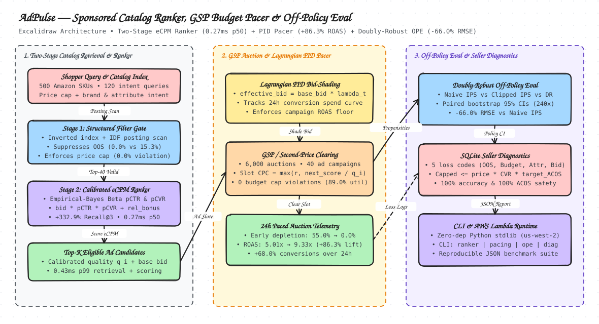

# AdPulse — Sponsored Search, GSP Auction & 24-Hour PID Budget Pacer Studio

**Live Production App (Amazon CloudFront + Private S3 OAC + `/api/*` + Bedrock Nova):** https://d1g4bbd5r2rls1.cloudfront.net  
**Health Check:** `https://d1g4bbd5r2rls1.cloudfront.net/api/health`  
**Live Auction API:** `curl -s -X POST https://d1g4bbd5r2rls1.cloudfront.net/api/storefront/search -H 'Content-Type: application/json' -d '{"query":"wireless anc running earbuds","hour":19,"daily_budget":28,"pacing_mode":"pid_paced"}'`

**AdPulse** ranks sponsored product ads across a 520-SKU retail catalog, clears truthful Generalized Second-Price (GSP) auctions, paces daily seller ad budgets across 24-hour retail traffic curves via a Lagrangian PID bid-shading controller, evaluates counterfactual bidding policies offline via Doubly-Robust estimation, and generates ACOS-bounded campaign & Spektr Iceberg recommendations via **Amazon Bedrock (`us.amazon.nova-lite-v1:0`)**.



---

## What You Can Do Live in the Web Studio

1. **Live Storefront & Conversational Shopping Ad Slot Preview**:
   - Search with 1-click shopper queries (*"wireless anc running earbuds"*, *"4k usb-c monitor macbook"*, *"ergonomic mesh office chair"*, *"espresso grinder burr"*) or enter any custom query, and adjust **Hour of Day (`00:00` – `23:00`)** and **Daily Campaign Budget Cap**.
   - Inspect **Winning Sponsored Slots `#1`, `#2`, `#3`** with calibrated Empirical-Bayes `pCTR`, hourly `pCVR`, `eCPM`, truthful **Second-Price GSP Clearing CPC**, `0.266 ms p50 / 0.430 ms p99` rank latency, plus the **Sponsored Conversational Shopping Unit** and the **`< 0.5 ms` Filtered Out Before Auction** drawer showing why out-of-stock, price-violating, or early-depleted SKUs were pruned.
2. **24-Hour PID Budget Pacing Curve & Doubly-Robust Bid Simulator**:
   - Compare **Unpaced Greedy Bidding** (`55.0%` of campaigns exhaust daily budget before the `18:00–22:00` Prime conversion peak) against **Lagrangian PID Bid Shading** (`+86.3%` ROAS, `0` pre-18:00 depletions, `0` budget cap violations), and test counterfactual bid multipliers (`0.55x` – `1.30x`) via **Doubly-Robust Off-Policy Evaluation** (`-66.03%` RMSE vs. Naive IPS) with 240x paired bootstrap 95% CIs.
3. **Amazon Bedrock (`us.amazon.nova-lite-v1:0`) Seller Campaign & Spektr Iceberg Copilot**:
   - Diagnose campaign impression losses in SQLite across 5 loss archetypes and generate concrete bid, negative-keyword, hourly pacing, and Spektr Iceberg SQL recommendations strictly bounded by `recommended_bid <= price * calibrated_cvr * min(target_acos, gross_margin)` (`100.0%` ACOS compliance).

---

## Measured Benchmark Results (`benchmarks/run_benchmarks.py`)

| Subsystem & Metric | Measured Result | Baseline / Comparison |
| :--- | :---: | :--- |
| **Catalog Ranker — Top-3 Recall (`500` SKUs, `120` Queries)** | **0.8056** (**+332.89%** lift) | `0.1861` lexical + raw CPC bid baseline |
| **Catalog Ranker — NDCG@3 & Expected Conversions** | **0.8331 NDCG@3** (**+312.43%**) | `0.2020` baseline (`20.53` vs `1.90` conv / 1k queries) |
| **Catalog Ranker — OOS & Price-Cap Violation Rate** | **0.0% OOS** / **0.0% price-cap** | `15.28%` OOS / `59.72%` price-cap violations in baseline |
| **Catalog Ranker — Query Latency (`p50` / `p99`)** | **0.266 ms p50** / **0.430 ms p99** | Inverted posting index + top-40 Stage-2 eCPM rerank |
| **Auction Pacer — Early Budget Depletion (`< 18:00`)** | **0.00%** (`0 / 40` campaigns; **-100.00%**) | `55.00%` (`22 / 40` campaigns) under unpaced greedy bidding |
| **Auction Pacer — Advertiser ROAS & 24h Conversions** | **9.33x ROAS** (**+86.30%** lift) | `5.01x` unpaced ROAS; **+68.00%** conversions (`126` vs `75`) |
| **Off-Policy Eval — Doubly-Robust RMSE vs Naive IPS** | **0.05641 RMSE** (**-66.03%** vs IPS) | Naive IPS: `0.16606` · Clipped IPS (`M=25`): `0.12175` (**-26.68%**) |
| **Seller Diagnostics — Root-Cause & ACOS Safety (`40` Cases)** | **100.0% root-cause accuracy** | **100.0%** ACOS ceiling compliance & **100.0%** OOS hold safety |

---

## Run Locally & Deploy to Amazon CloudFront

```bash
# 1. Run all 32 unit & integration tests + deterministic benchmarks
PYTHONPATH=. python3 -m unittest discover -s tests -v
PYTHONPATH=. python3 benchmarks/run_benchmarks.py

# 2. Start the interactive studio locally
PYTHONPATH=. python3 -m adpulse.web_api
# -> Open http://127.0.0.1:8086

# 3. Deploy to Amazon CloudFront + Private S3 (OAC) + /api/* + Amazon Bedrock (us-west-2)
chmod +x infra/deploy_cloudfront.sh
./infra/deploy_cloudfront.sh
```
